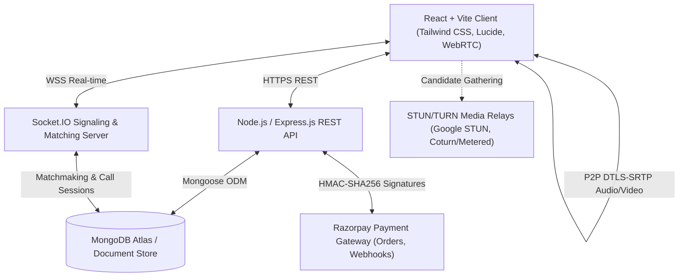

# Spotizan Platform Architecture

Spotizan is a production-oriented, 18+ live social discovery and peer-to-peer WebRTC video calling platform with an optional creator monetization marketplace and immutable double-entry wallet ledger.

---

## 1. High-Level System Architecture

---

## 2. Core Architectural Pillars

### A. Real-Time WebRTC Media Flow
- **Direct P2P Connectivity:** Browsers exchange Session Description Protocol (SDP) offers and answers through authenticated Socket.IO channels.
- **DTLS-SRTP Encryption:** All audio/video packets are cryptographically encrypted between peers without passing through intermediate unencrypted media bridges.
- **NAT Traversal:** Standard Google STUN (`stun:stun.l.google.com:19302`) with fallback TURN relays for restrictive enterprise symmetric NAT environments.

### B. Scalable Matchmaking Engine
- **In-Memory & Distributed Queue:** Supports single-instance deployment and is architected for Redis cluster scale (`LPUSH` / `RPOPLPUSH` atomic matching).
- **Preference Compatibility:** Filters candidates by language preferences, regional settings, and mutual interest tags.
- **Safety Exclusions:** Disallows matching between blocked user pairs (`UserBlock.exists`) and enforces a 2-minute anti-spam peer cooldown.
- **Priority Tier:** Premium and VIP subscribers receive front-of-queue priority insertion.

### C. Financial Ledger & Wallet Integrity
- **Paise Precision:** All currency calculations strictly use integer paise (₹1.00 = 100 paise) to eliminate JavaScript IEEE-754 floating point rounding drift.
- **Double-Entry Ledger:** `WalletAccount` balances are verified against immutable `LedgerEntry` audit logs.
- **Authoritative Server Timer:** The 15-second free preview guarantee and subsequent per-minute call billing (₹7/min promotional default) are calculated server-authoritatively upon session completion.
- **Atomic Balance Reservation:** When entering a paid call session, funds are reserved atomically; upon call hang-up, unused balances are refunded in real time.

---

## 3. Security, Privacy & Safety Architecture

1. **Role Enforcement:**
   - Female accounts hold the `CREATOR` role (unless staff `ADMIN`).
   - Male accounts hold the `CUSTOMER` role.
   - Staff accounts hold the `ADMIN` role.
2. **Strict 18+ Verification:** Legal majority declaration collected at registration with IP address and timestamp auditing. Underage accounts are automatically denied socket connection.
3. **Data Minimization:**
   - No audio/video call streams are recorded or stored.
   - In-call text chat messages are automatically expired and deleted after 24 hours via MongoDB TTL indices.
4. **Payment Gateway Security:**
   - Webhook and payment verification use timing-safe HMAC-SHA256 signature verification.
