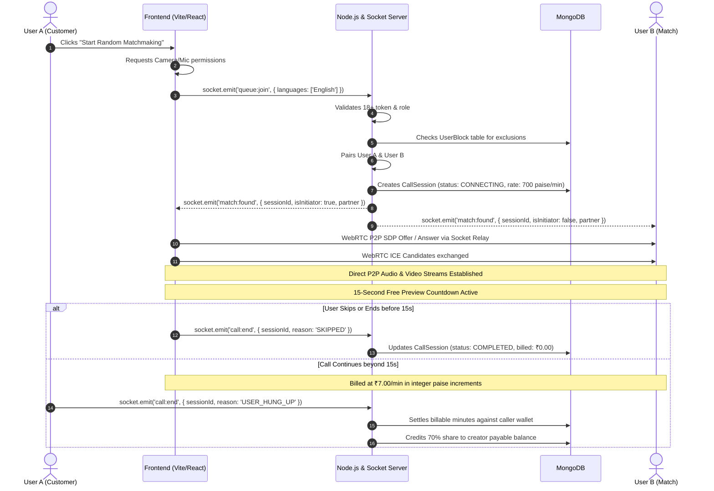

# Spotizan Main User Workflows & State Machines

This document outlines the end-to-end lifecycle of user registration, random video matching, paid creator calling, and moderation.

---

## 1. Random Matching & Video Call Workflow

---

## 2. In-Call Moderation & Safety Workflow

1. **User Action:** During a call, a participant clicks the **Trust & Safety (Shield)** button.
2. **Options:**
   - **Submit Report:** Selects reason (Inappropriate Behavior, Harassment, Underage Suspicion, Spam/Scam), adds optional details, and submits to `/api/reports`. The report is queued for immediate review in the Admin Console.
   - **Block & Next:** Instantly creates a permanent record in `UserBlock`, terminates the current session, and automatically queues the user for the next available, unblocked peer.
3. **Admin Resolution:** Staff reviews the session logs and KYC metadata in `/admin` and can ban the offending user's account or IP address.

---

## 3. Creator Monetization & Payout Workflow

1. **Onboarding:** A user registers (gender: `FEMALE`, role: `CREATOR`) and submits identity documents via `/api/creators/apply-verification`.
2. **Admin KYC Approval:** Staff reviews documents in the Admin Verification Queue and approves or rejects the application.
3. **Availability:** Once approved, the creator sets their status to `ONLINE` and defines their per-minute rate (minimum ₹5.00/min).
4. **Earnings:** The creator accumulates 70% of call earnings in `creatorPayablePaise`.
5. **Withdrawal:** The creator submits a payout request via UPI or Bank Transfer (minimum ₹500 / 50,000 paise). Staff reviews and processes payouts from `/api/admin/payouts`.
